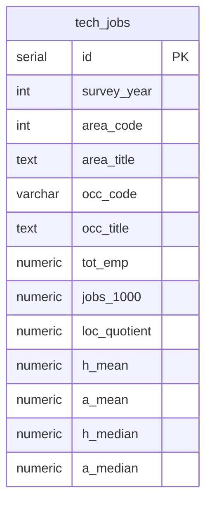

# PostgreSQL Database Design

Schema for importing cleaned BLS OEWS Metropolitan Area estimates from
`data/processed/bay_area_tech_jobs.csv`.

## Source data

| Property | Value |
|----------|-------|
| BLS survey | OEWS Metropolitan Area Employment and Wage Estimates |
| Release | M2025 (`MSA_M2025_dl.xlsx`) |
| Rows in CSV | 89 |
| Metro areas | 6 Bay Area MSAs |
| Occupations | 20 detailed SOC codes (major group 15-0000) |
| Grain | One row per survey year × metro area × occupation |

## Design overview

A single table, `tech_jobs`, holds the analysis columns plus a few identifiers
that keep the design stable as the project grows:

- `id` — surrogate primary key for future child tables
- `survey_year` — supports loading M2024, M2023, etc. later
- `area_code` — stable BLS metro code (preferred over title in keys)
- `area_title` — kept for readable queries and reports

The CSV is loaded through a staging table; all other source columns are dropped
on import.



## Table: `tech_jobs`

### Identifiers

| Column | Type | BLS CSV field | Description |
|--------|------|---------------|-------------|
| `id` | `SERIAL` | — | Surrogate primary key |
| `survey_year` | `INTEGER` | — | Estimate year (`2025` for M2025) |
| `area_code` | `INTEGER` | AREA | BLS metropolitan area code |
| `area_title` | `TEXT` | AREA_TITLE | Metropolitan area name |
| `occ_code` | `VARCHAR(10)` | OCC_CODE | SOC occupation code |
| `occ_title` | `TEXT` | OCC_TITLE | Occupation title |

Bay Area `area_code` values in the current dataset:

| area_code | area_title |
|-----------|------------|
| 34900 | Napa, CA |
| 41860 | San Francisco-Oakland-Fremont, CA |
| 41940 | San Jose-Sunnyvale-Santa Clara, CA |
| 42100 | Santa Cruz-Watsonville, CA |
| 42220 | Santa Rosa-Petaluma, CA |
| 46700 | Vallejo, CA |

### Analysis columns

| Column | Type | BLS CSV field | Description |
|--------|------|---------------|-------------|
| `tot_emp` | `NUMERIC(12,1)` | TOT_EMP | Total employment |
| `jobs_1000` | `NUMERIC(8,3)` | JOBS_1000 | Jobs per 1,000 jobs in the area |
| `loc_quotient` | `NUMERIC(6,2)` | LOC_QUOTIENT | Location quotient |
| `h_mean` | `NUMERIC(8,2)` | H_MEAN | Mean hourly wage ($) |
| `a_mean` | `NUMERIC(10,1)` | A_MEAN | Mean annual wage ($) |
| `h_median` | `NUMERIC(8,2)` | H_MEDIAN | Median hourly wage ($) |
| `a_median` | `NUMERIC(10,1)` | A_MEDIAN | Median annual wage ($) |

### Keys and constraints

| Constraint | Columns | Purpose |
|------------|---------|---------|
| Primary key | `id` | Simple reference for future related tables |
| Unique | `(survey_year, area_code, occ_code)` | One estimate per year, metro, and occupation |
| Check | `survey_year >= 2000` | Guard against bad year values |

**Nulls:** BLS suppressed values (`*`, `#`, `**`) and empty cells become
`NULL` on import. Two rows have suppressed employment but may still have wage values.

## Why this layout scales

| Future change | How the schema supports it |
|---------------|----------------------------|
| Load M2024 / M2023 data | Insert rows with a different `survey_year`; unique key still works |
| Add related tables | Child tables can reference `tech_jobs.id` |
| MSA title changes | `area_code` stays stable; update `area_title` on re-import |
| Time-series analysis | Filter or group by `survey_year` |

## Indexes

| Index | Columns | Purpose |
|-------|---------|---------|
| `idx_tech_jobs_survey_year` | `survey_year` | Filter by release year |
| `idx_tech_jobs_area_code` | `area_code` | Filter by metro |
| `idx_tech_jobs_a_median` | `a_median DESC NULLS LAST` | Highest-paying roles |
| `idx_tech_jobs_tot_emp` | `tot_emp DESC NULLS LAST` | Highest employment |
| `idx_tech_jobs_occ_code` | `occ_code` | Filter by occupation |

## Import workflow

SQL lives in `sql/schema.sql` and `sql/import_bay_area_tech_jobs.sql`.

1. Run `schema.sql` to create the `tech_jobs` table, staging table, and
   helper function `bls_text_to_numeric()`.
2. Load the full CSV into `staging_bay_area_tech_jobs`.
3. Run `import_bay_area_tech_jobs.sql` to insert rows with `survey_year = 2025`.

```bash
psql -d bayarea_tech_jobs_db -f sql/schema.sql

psql -d bayarea_tech_jobs_db -c "\copy bay_area_jobs.staging_bay_area_tech_jobs FROM 'data/processed/bay_area_tech_jobs.csv' WITH (FORMAT csv, HEADER true, QUOTE '\"', ESCAPE '\"')"

psql -d bayarea_tech_jobs_db -f sql/import_bay_area_tech_jobs.sql
```

To load another BLS release later, stage that CSV and set `survey_year` to the
matching year in the import script (for example `2024` for M2024).

## Example analysis queries

**Highest median annual wage (current release):**

```sql
SELECT area_title, occ_title, a_median, tot_emp
FROM bay_area_jobs.tech_jobs
WHERE survey_year = 2025
  AND a_median IS NOT NULL
ORDER BY a_median DESC
LIMIT 10;
```

**Tech employment concentration (location quotient > 1):**

```sql
SELECT area_title, occ_title, loc_quotient, tot_emp
FROM bay_area_jobs.tech_jobs
WHERE survey_year = 2025
  AND loc_quotient > 1
ORDER BY loc_quotient DESC;
```

**Total employment by metro:**

```sql
SELECT area_title, SUM(tot_emp) AS total_tech_employment
FROM bay_area_jobs.tech_jobs
WHERE survey_year = 2025
  AND tot_emp IS NOT NULL
GROUP BY area_title
ORDER BY total_tech_employment DESC;
```

**Future time-series example (once multiple years are loaded):**

```sql
SELECT survey_year, area_title, occ_title, a_median
FROM bay_area_jobs.tech_jobs
WHERE area_code = 41940
  AND occ_code = '15-1252'
ORDER BY survey_year;
```

## Future extensions

Columns:
